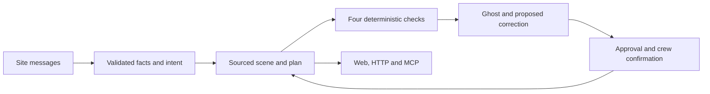

# Site Rehearsal

### See tomorrow's mistake before it gets built.

A wall moves in the office chat. The plumber still plans from the old line. **Site Rehearsal makes that mismatch visible before work starts.** It turns crew messages into a sourced model of one floor, checks intended work, and shows the conflicting position as a red ghost wall.

[Run the demo](#run-the-demo) · [How it works](#one-record-from-intent-to-confirmation) · [Evidence](#measured-not-assumed) · [Architecture](docs/architecture.md)

Built for the **Talona · Context for the Physical World** track at proximata Hackathon '26. All site data is simulated. The model represents the record, not verified construction.


The floor stays in view. **Today** holds the next decisions; **Record** holds sources and revisions; **Learning** holds corrections you can inspect and undo.

## Run the demo

Requires **Node.js 22.12+** and npm. From the repository root:

```sh
npm install
npm run demo
```

Open **[localhost:5173](http://localhost:5173)**. After installation, the prepared replay runs offline with cached model outputs—no API key required. The API uses port `8787`; stop an existing demo before starting another on the same ports.

| Explore | Open | What to do |
|---|---|---|
| Guided demonstration | [Presenter](http://localhost:5173/?present=1) | Press **R** to start clean, **→** to advance, **←** to revisit, **H** to hide controls |
| Superintendent workspace | [Floor plan](http://localhost:5173) | Inspect a risk, read its sources, send a correction and track confirmation |
| Crew view | [Phone](http://localhost:5173/phone) | Send a prepared message or ask a question about the record |

**Want to type something new?** Copy [`.env.example`](.env.example) to `.env`, set `GROQ_API_KEY`, then start:

```sh
npm run demo:live
```

Prepared messages still use their cache; unfamiliar wording uses live extraction. Offline cache misses and failed live calls are reported as **not checked**, never clearance. Live mode requires network access and is subject to model errors and rate limits. Keep `.env` private.

## One record, from intent to confirmation

The superintendent needs to know what matters, why it matters, and which action comes next.

| Step | What the product does |
|---|---|
| **Understand the plan** | Extract crew intent and scene changes from messages, retaining source and confidence. |
| **Expose the mismatch** | Check latest changes, shared space, work order and open decisions. Show the ghost beside the recorded wall. |
| **Rehearse tomorrow** | Play the planned work forward and surface the top three huddle items. |
| **Send the correction** | Let the superintendent approve a sourced crew message. The risk remains open while confirmation is pending. |
| **Confirm and recheck** | Record an explicit simulated crew reply for that revision, reject stale replies, and retain the incident receipt. |
| **Remember the lesson** | Reuse a corrected location nickname; remember an exact incident review with a reason and Undo. |

Text-only sheet comparisons also flag a difference between an explicitly issued revision and the revision a crew says it holds. No drawing attachment is read. An acknowledgement records receipt in the simulation; it does not establish inspection, completed work or physical safety.

## Measured, not assumed

The recorded evaluations include both the prepared demonstration and a separate challenge. All data is synthetic; these results are **not field performance**.

| Evaluation | Caught | Missed | False alarms | Interpretation |
|---|---:|---:|---:|---|
| [Golden replay](eval/results.json) | 15 / 15 | 0 | 0 | Development/regression set; 190 messages |
| [Challenge, first run](eval/results.challenge.json) | 6 / 14 | 8 | 5 | Separate set committed before its first run; 64 messages |
| [Challenge, second run](eval/results.challenge.run2.json) | 8 / 14 | 6 | 4 | After a calendar-prompt fix motivated by run 1; no longer unseen |

Golden results combine live and evening checks. Live checks alone catch 14 of 15; rehearsal catches the remaining case. Challenge failures expose extraction gaps and limitations around cancellations, future plans and uncertain work prerequisites. The reports preserve those failures instead of presenting the prepared demo as general accuracy.

See [evaluation methodology](eval/README.md), [golden case details](eval/results.detail.json) and [challenge data](data/challenge/) for sources, matching rules and per-case results.

## Inside the system

**The LLM extracts facts. Rules decide.**



TypeScript throughout: Node HTTP server, zod contracts, React/Vite interface, SVG floor plan and an optional three.js renderer of the same scene. Groq handles extraction and question parsing; check logic contains no LLM calls. Replay logic uses recorded time for repeatable results. Agents and the [demo robot planner](mcp/README.md) query the same record through MCP.

This is a standalone prototype, not a deployed Talona integration. It supports one floor and text input. Thread membership is a proxy for information availability, not proof of what a person read. Learning stores explicit corrections and review decisions; it does not retrain a model.

## Develop and verify

| Command | Purpose |
|---|---|
| `npm run dev` | Server and web with hot reload |
| `npm run typecheck` | Check all workspaces and HTTP tests |
| `npm test` | Unit tests; add `-- server/checks` to target checks |
| `npm run e2e` | HTTP demo story against a spawned server on port `8790` |
| `npm run eval` | Score the golden replay and write evaluation reports |
| `npm run eval:challenge` | Score the separate challenge; `-- --run=2` selects run 2 |
| `npm run eval:paraphrase` | Run three development cases with uncached model calls |
| `npm run build -w @site/web` | Build the web interface |

On Windows, use `npm.cmd` if PowerShell blocks `npm.ps1`. Evaluation with missing live outputs requires a Groq key; unavailable calls are not successful negative cases. Recording instructions live in [`video/README.md`](video/README.md).

<details>
<summary><strong>Configuration and advanced commands</strong></summary>

The prepared offline replay needs no environment configuration. Defaults and comments are in [`.env.example`](.env.example).

| Variable | Purpose |
|---|---|
| `GROQ_API_KEY` | Required for live calls and cache building |
| `GROQ_MODEL` | Default: `openai/gpt-oss-120b` |
| `LIVE_LLM` | Defaults to `0`; `demo:live` enables live extraction |
| `PORT` | API port; default `8787` |
| `API_PORT`, `WEB_PORT` | Optional Vite proxy target and web port for an isolated demo |
| `SITE_API` | MCP API address; default `http://127.0.0.1:8787` |
| `LEARNING_FILE` | Optional persisted corrections, e.g. `.learning/store.json` |
| `E2E_PORT` | Optional HTTP test server port |

Without `LEARNING_FILE`, learning lives in memory. With it, review preferences use a companion `.dismissals.json` file. Receipts remain session-local. `POST /api/reset {"keepLearning":true}` retains learning; `false` starts clean and clears persisted learning.

```sh
# Inspect a prepared phone message's cache key
npm run cache-id -- "tomorrow morning we close up the blue room" crew-drywall

# Build extraction or question caches (requires GROQ_API_KEY)
node --import tsx server/extract/build-cache.ts
node --import tsx server/query/build-cache.ts

# Expose the record to agents, or run the sample consumer
npm run start -w @site/mcp
npm run robot -w @site/mcp
```

Cache builders preserve existing entries unless `--force` is supplied. Extraction also supports `--only=id,other-id`. Interactive live outputs go to the gitignored `data/llm-cache-live/`; do not replace golden evidence to hide failures.

For integration work, see [architecture](docs/architecture.md), [HTTP route definitions](server/api/index.ts), [request/response contracts](contracts/src/) and the [MCP guide](mcp/README.md).

</details>

## Project guide

[Demo script](docs/demo-script.md) · [Architecture and dependencies](docs/architecture.md) · [Talona alignment](docs/TALONA_ALIGNMENT.md) · [Design decisions](docs/decisions.md)

Maintained by the team listed in [TEAM.md](TEAM.md). AI coding tools should begin with [AGENTS.md](AGENTS.md), then check [current ownership](docs/PARALLEL_STATUS.md) and the [continuation handoff](docs/CLAUDE_RESUME.md) before editing.
