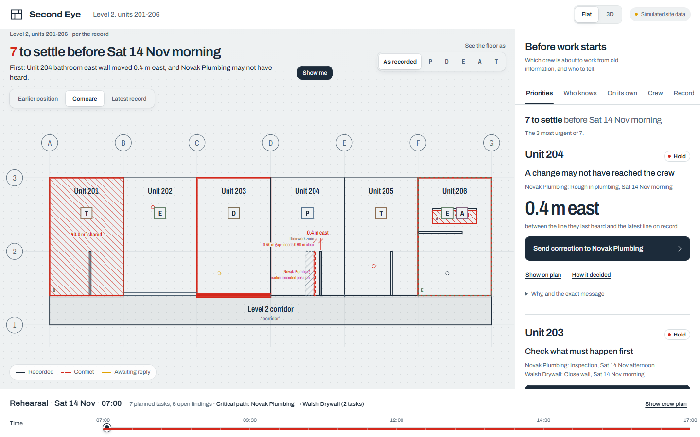
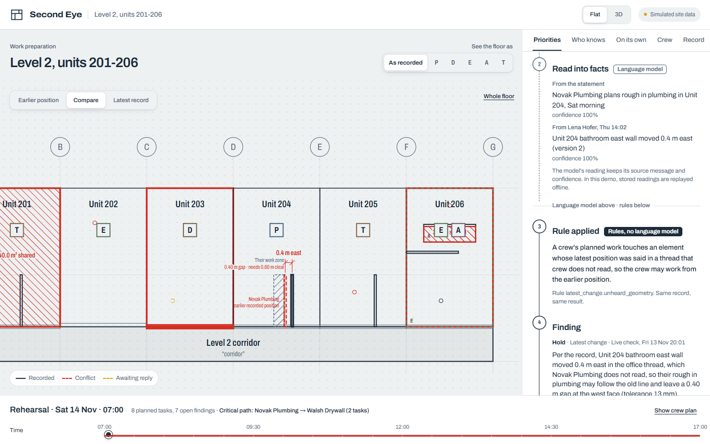
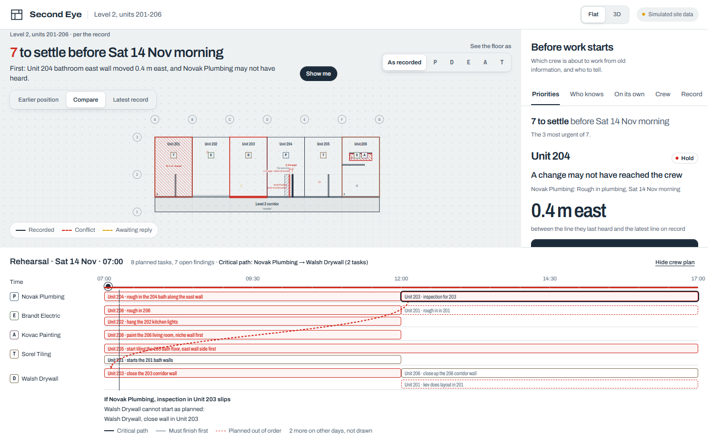
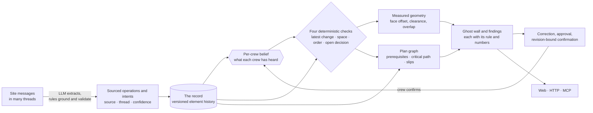

<div align="center">


# Second Eye

**See tomorrow's mistake before it gets built.**

A wall moves in the office chat. The plumber still plans from the old line.<br>
Second Eye turns crew messages into a sourced model of one floor, checks every stated plan against it,<br>
and shows the conflicting position as a red **ghost wall** before work starts.

[](docs/TALONA_ALIGNMENT.md)
[](#quick-start)
[](docs/architecture.md)
[](#quick-start)
[](#boundaries)
[](mcp/README.md)

**[Open the live demo](https://site-rehearsal.onrender.com)** · [Guided presenter](https://site-rehearsal.onrender.com/?present=1) · [Crew phone](https://site-rehearsal.onrender.com/phone)

[Quick start](#quick-start) · [How it works](#how-it-works) · [Measured results](#measured-not-assumed) · [Architecture](docs/architecture.md) · [Demo script](docs/demo-script.md)

<br>



</div>

<br>

> [!IMPORTANT]
> **Hackathon prototype on simulated data.** Built for the Talona · Context for the Physical World track at proximata Hackathon '26. The model reflects what was *said in the record*, not what was built. A crew acknowledgement records receipt in the simulation; it does not establish inspection, completed work or physical safety.

## What it is

The superintendent needs to know, before 07:00, which crew is about to work from old information, and who to tell. Second Eye answers with one shared record and one checking engine, run at two moments: the instant a crew states its plan, and again the evening before.

| Step | What the product does |
|---|---|
| **Understand the plan** | Extracts crew intent and scene changes from messages. Every fact keeps its source message and a confidence. |
| **Expose the mismatch** | Runs four deterministic checks: latest change, shared space, order of work and open decision. Measures the gap between the wall face a crew believes in and the recorded face, and the floor two crews' work zones share. Draws the ghost beside the recorded wall. |
| **Show how it decided** | Traces every finding from the message, through the facts the language model read, to the rule that fired and the measured result. |
| **Rehearse tomorrow** | Plays the planned work forward on a time slider, draws what must finish first, marks the critical path and says who is blocked if a task slips. Puts the three most important items first. |
| **Send the correction** | The superintendent approves a sourced crew message in one tap. The risk stays open, in amber, until the crew confirms. |
| **Confirm and recheck** | Records an explicit simulated reply for that exact revision, rejects stale replies and keeps an incident receipt. |
| **Remember the lesson** | Reuses a corrected location nickname. Remembers a reviewed incident, with the reason and an Undo. |

Text-only sheet comparisons also flag a difference between an issued revision and the one a crew says it holds. No drawing attachments are read.

## How it works

### One floor, many versions of it

Most tools keep one model of the building. A site doesn't have one. Each crew works from **its own version**: the changes said in the threads it reads, and none of the ones it doesn't.

Second Eye models that directly. Every change to every element keeps the thread it was said in. From that history the engine derives, **per crew**, where that crew believes each wall is (`knownGeometry(element, crew)`). A ghost wall is the difference between one crew's belief and the record, at the place where its planned work meets it. The same view works in the flat plan and in 3D, where the walls glide to where the chosen crew believes they are.

<div align="center">

<br><sub>"See the floor as" any crew. The matrix shows every change against every crew: heard, not heard, or not heard where the checks find that crew's work meets it.</sub>
</div>

### Measured, not just flagged

The checks work in metres. Walls are thick segments and rooms are polygons. For a latest change, the engine finds the face of the wall the crew works on, measures perpendicular to it between the face the crew believes in and the recorded face, and compares that with the clear working depth and the tolerance for that trade. A move into the work side lands the work inside the new wall; a move away leaves a gap. For a space clash, it intersects the two crews' work zones and reports the shared floor area. Every number comes from one rules file, [`geometry-rules.ts`](server/checks/geometry-rules.ts), with a one-line reason per value: a building code where one applies, otherwise a labelled assumption. None were tuned on the labelled cases.

On the simulated data, per the record, the ghost wall measures a **0.40 m gap** at the west face of the Unit 204 bathroom wall, where plumbing rough-in needs 0.60 m clear and tolerates 13 mm. So it is a hold.

<div align="center">

<br><sub>"How it decided", one click from every incident card: what was said, what the language model read from it (with confidence), the rule that fired (no language model), the measured result and whether the fix was confirmed.</sub>
</div>

### Tomorrow as a graph

The evening rehearsal builds tomorrow's plan as a dependency graph from one prerequisite table (rough-in, inspection, close the wall, finish, paint or tile, per place). An order-of-work finding is a violated edge of that graph. The longest chain in half-day slots is the critical path, and for every task the engine works out which crews can no longer start as planned if it slips by one slot. On the simulated Saturday the critical path is the Unit 203 inspection followed by closing the 203 corridor wall, and that edge is out of order.

<div align="center">

<br><sub>"Show crew plan": arrows for what must finish first, the critical path in heavy ink, out-of-order work dashed red, and who is blocked if the selected task slips.</sub>
</div>



**The LLM extracts facts. Rules decide.** No model call sits inside the checks, the geometry or the plan graph, and replays run on recorded time, so the same input always gives the same output. In live mode, rules also audit the model's reading: a wall named for a unit the message never mentions is dropped, and a message with a distance and a direction but no extracted move is read a second time. Sending a correction doesn't clear the risk; only a reply that confirms the current revision does.

### Stack

It is TypeScript throughout:

- Node HTTP server, zod contracts and a React/Vite interface.
- An SVG floor plan that always works, plus an optional three.js renderer of the same scene.
- Groq handles extraction and question parsing.
- Replays run on recorded time, so results repeat exactly.
- Agents and the [demo robot planner](mcp/README.md) query the same record through MCP.

## Quick start

Requires **Node.js 22.12+** and npm. From the repository root:

```sh
npm install
npm run demo
```

Open **[localhost:5173](http://localhost:5173)**. The prepared replay runs offline with cached model outputs, so no API key is needed. The API listens on port `8787`; stop any running demo before you start another.

| Explore | Open | What to do |
|---|---|---|
| Guided demonstration | [Presenter](http://localhost:5173/?present=1) | **R** starts clean, **→** advances, **←** goes back, **H** hides the controls |
| Superintendent desk | [Floor plan](http://localhost:5173) | Inspect a risk, read its sources, send a correction, track the confirmation |
| Crew view | [Phone](http://localhost:5173/phone) | Send a prepared message, or ask a question about the record |

**Want to type something new?** Copy [`.env.example`](.env.example) to `.env`, set `GROQ_API_KEY`, then run `npm run demo:live`.

Prepared messages still use their cache; unfamiliar wording goes to live extraction. If the cache misses offline or a live call fails, the message is reported as **not checked**, never as clear. Live mode needs network access and can hit model errors and rate limits.

## Measured, not assumed

Every number below comes from `npm run eval` or `npm run eval:challenge`. All data is synthetic, so these are **not field results**.

| Evaluation | Caught | Missed | False alarms | Notes |
|---|---:|---:|---:|---|
| [Golden replay](eval/results.json) | **15 / 15** | 0 | 0 | Development and regression set; 190 messages |
| [Challenge, first run](eval/results.challenge.json) | 6 / 14 | 8 | 5 | Separate set, committed before its first run; 64 messages |
| [Challenge, second run](eval/results.challenge.run2.json) | 8 / 14 | 6 | 4 | After a calendar-prompt fix that run 1 motivated; no longer unseen |
| [Challenge, third run](eval/results.challenge.run3.json) | 9 / 14 | 5 | 2 | After general extraction rules (cancellations, unit grounding, trade terms); not unseen; 55 of 64 messages read exactly |

Golden results combine the live and evening checks: live checks alone catch 14 of 15, and the rehearsal catches the last one. The challenge failures show extraction gaps around cancellations, future plans and uncertain prerequisites. We kept those failures in the reports so the prepared demo isn't mistaken for general accuracy.

Methodology: [evaluation guide](eval/README.md) · [golden case details](eval/results.detail.json) · [challenge data](data/challenge/).

## Boundaries

- **Simulated.** Every screen that shows site data says so.
- **Record, not reality.** Thread membership stands in for what a crew could have seen; it is not proof of what anyone read.
- **Fails closed.** Missing or failed extraction is "not checked", never "clear".
- **Sent is not confirmed.** A geometry risk turns green only after an explicit reply for the current revision.
- **Learning is explicit.** It stores corrections and review decisions with Undo. No model is retrained.
- **Scope.** A standalone prototype: one floor, text input, no deployed Talona integration.

## Develop and verify

| Command | Purpose |
|---|---|
| `npm run dev` | Server and web with hot reload |
| `npm run typecheck` | Check all workspaces and the HTTP tests |
| `npm test` | Unit tests; add `-- server/checks` to target one folder |
| `npm run e2e` | HTTP demo story against a spawned server on port `8790` |
| `npm run eval` | Score the golden replay and write the evaluation reports |
| `npm run eval:challenge` | Score the separate challenge; `-- --run=2` selects run 2 |
| `npm run eval:paraphrase` | Run three development cases with uncached model calls |
| `npm run build -w @site/web` | Build the web interface |

**Hosted demo** at [site-rehearsal.onrender.com](https://site-rehearsal.onrender.com) (the address keeps the project's earlier name). [`render.yaml`](render.yaml) deploys one Render web service that runs the API and serves the built web app (`server/static.ts`). Every push to `main` redeploys. It runs the offline replay only: no API key, live extraction off. All visitors share one in-memory record, so press **R** in the presenter to start clean.

On Windows, use `npm.cmd` if PowerShell blocks `npm.ps1`. Evaluating outputs that aren't cached needs a Groq key; a call that can't run doesn't count as a successful negative. Recording instructions are in [`video/README.md`](video/README.md).

<details>
<summary><strong>Configuration and advanced commands</strong></summary>

<br>

The prepared offline replay needs no environment configuration. Defaults and comments are in [`.env.example`](.env.example).

| Variable | Purpose |
|---|---|
| `GROQ_API_KEY` | Required for live calls and cache building |
| `GROQ_MODEL` | Default: `openai/gpt-oss-120b` |
| `LIVE_LLM` | Defaults to `0`; `demo:live` enables live extraction |
| `PORT` | API port; default `8787` |
| `API_PORT`, `WEB_PORT` | Optional Vite proxy target and web port for an isolated demo |
| `SITE_API` | MCP API address; default `http://127.0.0.1:8787` |
| `LEARNING_FILE` | Optional persisted corrections, e.g. `.learning/store.json` |
| `E2E_PORT` | Optional HTTP test server port |

Without `LEARNING_FILE`, learning lives in memory. With it, review preferences go to a companion `.dismissals.json` file. Receipts stay session-local. `POST /api/reset {"keepLearning":true}` keeps learning; `false` starts clean and clears persisted learning.

```sh
# Inspect a prepared phone message's cache key
npm run cache-id -- "tomorrow morning we close up the blue room" crew-drywall

# Build extraction or question caches (requires GROQ_API_KEY)
node --import tsx server/extract/build-cache.ts
node --import tsx server/query/build-cache.ts

# Expose the record to agents, or run the sample consumer
npm run start -w @site/mcp
npm run robot -w @site/mcp
```

Cache builders keep existing entries unless you pass `--force`. Extraction also supports `--only=id,other-id`. Interactive live outputs go to the gitignored `data/llm-cache-live/`. Never replace golden evidence to hide a failure.

</details>

## Repository layout

```text
contracts/   zod schemas: Operation, Scene, CrewIntent, Finding, API shapes (frozen)
data/        synthetic chat, golden replay, LLM cache, labelled test sets
server/
  extract/   LLM: message to operations and crew intent
  model/     scene state, element history, applying operations
  checks/    the four deterministic checks, measured geometry, rehearsal and plan graph, fix proposals
  learning/  stored corrections and how they change the next run
  query/     questions about the record and the morning briefing
  sheets/    text-only sheet revision checks
  agent/     what the system does on its own, with its reasons
  api/       HTTP routes
web/         flat plan, 3D view, rehearsal slider, site desk, crew phone, presenter
eval/        evaluation runner and recorded results
mcp/         MCP server and the demo robot planner
e2e/         HTTP demo story tests
video/       scripted recording of the presenter beats
docs/        demo script, architecture, decisions, design review
```

[Demo script](docs/demo-script.md) · [Architecture and dependencies](docs/architecture.md) · [Talona alignment](docs/TALONA_ALIGNMENT.md) · [Design decisions](docs/decisions.md) · [HTTP routes](server/api/index.ts) · [Contracts](contracts/src/) · [MCP guide](mcp/README.md)

The team is listed in [TEAM.md](TEAM.md). AI coding tools start with [AGENTS.md](AGENTS.md), then check [current ownership](docs/PARALLEL_STATUS.md) before editing.

<br>

<div align="center">
<sub>Simulated site data · Hackathon prototype · The record, not the building</sub>
</div>
