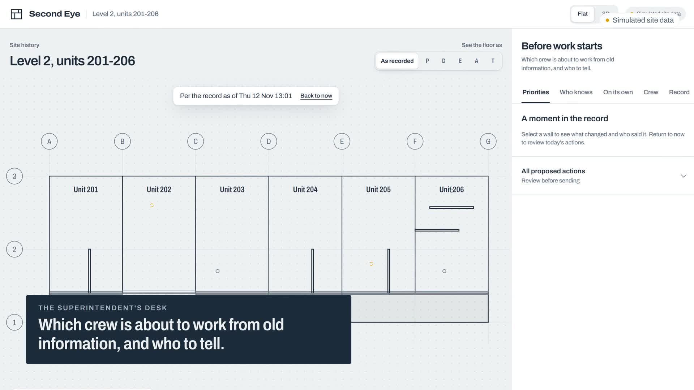
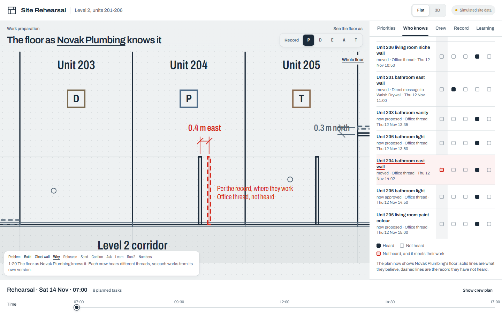
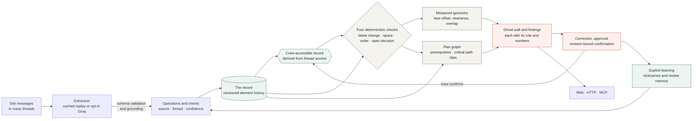

<div align="center">


# Second Eye

**See tomorrow's mistake before it gets built.**

**Spatial coordination intelligence for construction teams.**<br>
Turn crew messages into a traceable project record, detect conflicting plans,<br>
and coordinate corrections before work begins.

[](https://site-rehearsal.onrender.com)
[](#system-architecture)

[](docs/TALONA_ALIGNMENT.md)
[](#quick-start)
[](#boundaries)

**[Open the live demo](https://site-rehearsal.onrender.com)** · [Guided presenter](https://site-rehearsal.onrender.com/?present=1) · [Crew phone](https://site-rehearsal.onrender.com/phone)

[Read the pitch deck (PDF)](docs/deck/deck.pdf) · [Run it locally](#quick-start)

[Live demo](#try-second-eye) · [How it works](#how-it-works) · [Architecture](#system-architecture) · [Technical stack](#technical-stack) · [Results](#measured-not-assumed) · [Quick start](#quick-start)

<br>

<a href="docs/assets/readme/second-eye-demo-silent.mp4"></a>

<strong><a href="docs/assets/readme/second-eye-demo-silent.mp4">▶ Watch the product film · 2:18 · No sound</a></strong><br>
<sub>On-screen captions tell the story. Click the preview to open the MP4. Simulated site data.</sub>

</div>

<br>

> [!IMPORTANT]
> **Hackathon prototype on simulated data.** Built for the Talona · Context for the Physical World track at proximata Hackathon '26. The model reflects what was *said in the record*, not what was built. A crew acknowledgement records receipt in the simulation; it does not establish inspection, completed work or physical safety.

## Overview

Second Eye is a construction coordination prototype that connects site communication with spatial and scheduling context. It transforms crew messages into a versioned model of one floor, compares intended work with the latest recorded changes, and identifies conflicts in geometry, shared work areas, task dependencies and unresolved decisions.

Each finding links back to its source messages, extracted facts and the rule that produced it. A superintendent can review a proposed correction, track confirmation of the relevant revision, and inspect the resulting recheck. The same record supports a web workspace, a crew phone interface and read-only access for AI agents through the Model Context Protocol (MCP).

## Try Second Eye

**[Launch the live application →](https://site-rehearsal.onrender.com)**

No installation or API key is required for the prepared demonstration.

| Experience | Direct link | What to explore |
|---|---|---|
| **Superintendent workspace** | [Open the application](https://site-rehearsal.onrender.com) | Floor plan, incident evidence, corrections and tomorrow's work |
| **Guided demonstration** | [Start the presenter](https://site-rehearsal.onrender.com/?present=1) | Press **R** to reset, then **→** to follow the twelve-beat story |
| **Crew phone** | [Open the phone interface](https://site-rehearsal.onrender.com/phone) | Prepared crew messages and sourced responses |
| **Silent product film** | [Watch or download the MP4](docs/assets/readme/second-eye-demo-silent.mp4) | A captioned 2:18 overview of the ghost wall, correction and learning loop |
| **Pitch deck** | [Read the PDF](docs/deck/deck.pdf) | The problem, product and demonstration story |

The hosted demo uses cached extraction and simulated data. Visitors share one session; resetting it also resets the shared demonstration. For an isolated session or unfamiliar message wording, use the [local setup](#quick-start).

The film is an earlier recorded walkthrough of the 15-case scenario, assembled from app captures with captions and camera motion. The current application includes additional technical views shown below. It is a product overview, separate from the full presenter recording. [Video source and export details](docs/assets/readme/VIDEO.md).

## One wall. Two versions. One chance to intervene.

It is the evening before work starts. The architect has moved the bathroom wall in Unit 204 by **40 cm**. That change is in the office thread. Plumbing's stated plan still uses the old line.

Second Eye puts both lines on the floor plan. The red **ghost wall** shows the mismatch. Beside it are the messages that explain the risk, the crew affected, and a correction ready for the superintendent to review.

**The promise is simple: make a coordination mistake visible while there is still time to question the plan.**

| In the site record | On the superintendent's desk |
|---|---|
| A change is buried in another thread | The old and latest wall lines appear together |
| Two crews book the same work area | Their overlapping work zones are highlighted |
| A crew plans to close a wall before inspection | The missing prerequisite is shown on tomorrow's timeline |
| A crew plans around an unresolved decision | The decision and its source stay visible for review |

## From a warning to a closed loop

The superintendent needs to know, before 07:00, which crew is about to work from old information, and who to tell. Second Eye answers with one shared record and one checking engine, run at two moments: the instant a crew states its plan, and again the evening before.

| Step | What the product does |
|---|---|
| **Understand the plan** | Extracts crew intent and scene changes from messages. Every fact keeps its source message and a confidence. |
| **Expose the mismatch** | Checks changes, shared space, work order and open decisions. Measures the difference between recorded wall versions and the overlap between work areas. |
| **Show how it decided** | Traces every finding from the message, through the facts the language model read, to the rule that fired and the measured result. |
| **Rehearse tomorrow** | Checks morning and afternoon plans, shows what must happen first, and identifies which crews a delay would block. Puts the three most important items first. |
| **Send the correction** | The superintendent approves a sourced crew message in one tap. The risk stays open, in amber, until the crew confirms. |
| **Confirm and recheck** | Records an explicit simulated reply for that exact revision, rejects stale replies and keeps an incident receipt. |
| **Remember the lesson** | Reuses a corrected location nickname. Remembers a reviewed incident, with the reason and an Undo. |

Text-only sheet comparisons also flag a difference between an issued revision and the one a crew says it holds. No drawing attachments are read.


*The working prototype: one floor, one shared record, and a desk organized around what needs attention before work starts.*

## A three-minute tour

Open the [guided presenter](https://site-rehearsal.onrender.com/?present=1), press **R** to start clean, then **→** to advance. The hosted prototype shares a session across visitors; use the [local demo](#quick-start) for an isolated presentation.

1. **See the mistake.** Compare the latest wall line with the version available in the crew's threads.
2. **Inspect the evidence.** Open “How it decided”: message → extracted fact → rule → measured result.
3. **Check tomorrow.** See the order of work and the crews affected by a delay.
4. **Close the communication loop.** Send the correction, see amber while waiting, then simulate a revision-specific reply and recheck.
5. **Show the lesson sticking.** Map “the blue room” once, then reuse the same words on the next run.

The [presenter script](docs/demo-script.md) contains all twelve beats. The [pitch deck](docs/deck/deck.pdf) gives the short story; the [architecture guide](docs/architecture.md) supplies the technical detail.

## How it works

### One floor, many versions of it

The latest project record and the information available to a crew can be different. Second Eye compares **three things: the latest record, the crew-accessible record, and the work that crew intends to do.**

Every change keeps its source message and thread. The engine uses thread access to derive the wall version available to each crew. That is a proxy for information availability, not proof of what anyone read or believes. A ghost highlights the difference where the crew's stated work meets the wall. The flat plan and optional 3D view show the same record.

<div align="center">

<br><sub>Compare the latest record with the version available in each crew's threads. The matrix highlights information gaps that intersect planned work.</sub>
</div>

### Measured, not just flagged

The checks work in metres. Walls are thick segments and rooms are polygons. For a latest change, the engine measures the perpendicular offset between recorded wall faces and compares it with configured trade clearances and tolerances. For a space clash, it intersects the crews' work zones and reports the shared floor area. Thresholds and their stated rationale are inspectable in [`geometry-rules.ts`](server/checks/geometry-rules.ts). These prototype rules are not a certification of code compliance or physical safety.

On the simulated data, per the record, the ghost wall measures a **0.40 m gap** at the west face of the Unit 204 bathroom wall, where plumbing rough-in needs 0.60 m clear and tolerates 13 mm. So it is a hold.

<div align="center">

<br><sub>"How it decided", one click from every incident card: what was said, what the language model read from it (with confidence), the rule that fired (no language model), the measured result and whether the fix was confirmed.</sub>
</div>

### Tomorrow as a graph

The evening rehearsal builds tomorrow's plan as a dependency graph from one prerequisite table (rough-in, inspection, close the wall, finish, paint or tile, per place). An order-of-work finding is a violated edge of that graph. The longest chain in half-day slots is the critical path, and for every task the engine works out which crews can no longer start as planned if it slips by one slot. On the simulated Saturday the critical path is the Unit 203 inspection followed by closing the 203 corridor wall, and that edge is out of order.

<div align="center">

<br><sub>"Show crew plan": arrows for what must finish first, the critical path in heavy ink, out-of-order work dashed red, and who is blocked if the selected task slips.</sub>
</div>

## System architecture

**The language model extracts facts. Deterministic rules decide which plans conflict.** A shared TypeScript contract connects extraction, the versioned record, the checking engine and every client. Both immediate intent checks and evening rehearsal use the same rules.



| Layer | Responsibility | Implementation |
|---|---|---|
| **Contracts and extraction** | Validate messages as typed operations and intent; preserve sources and confidence | [`contracts/`](contracts/src/), [`server/extract/`](server/extract/) |
| **Versioned scene** | Apply changes, retain element history and derive recorded plans | [`server/model/`](server/model/) |
| **Checking engine** | Evaluate four conflict categories, wall-face offsets and overlapping work zones | [`server/checks/`](server/checks/) |
| **Plan graph** | Derive prerequisites, the critical path and effects of a one-slot delay | [`graph.ts`](server/checks/graph.ts), [`rehearse.ts`](server/checks/rehearse.ts) |
| **Correction and learning** | Track revision-specific receipts, reject stale confirmations and retain explicit corrections | [`server/api/`](server/api/), [`server/learning/`](server/learning/) |
| **Clients** | Present the same record through flat/3D views, the crew phone, HTTP and MCP | [`web/`](web/), [`mcp/`](mcp/) |

### Engineering principles

- **Traceable decisions.** Every operation and finding carries `sourceMessageId`; findings expose evidence, rule identifiers and applicable measurements.
- **Reproducible checks.** Checks, geometry and the plan graph contain no language-model calls. Cached replay and recorded time make the prepared demonstration repeatable; fresh model extraction can vary.
- **Explicit uncertainty.** Missing extraction is “not checked.” Uncertain locations are not silently guessed. Grounding checks reject references to units absent from the message.
- **Revision-aware confirmation.** Dispatch remains separate from receipt. An acknowledgement for a superseded revision is rejected; duplicate confirmations are idempotent.
- **Shared spatial state.** The SVG and three.js renderers consume the same scene. The 3D view is a second presentation of the record, not another model of truth.
- **Inspectable learning.** Nickname corrections and review memory alter subsequent behavior without model retraining.

Full implementation detail: [architecture and data flow](docs/architecture.md) · [MCP tools and example consumer](mcp/README.md) · [evaluation methodology](eval/README.md).

## Technical stack

| Area | Technology | Purpose |
|---|---|---|
| Language and contracts | TypeScript, Zod, npm workspaces | Shared types and runtime validation across modules |
| Web interface | React, Vite, SVG, three.js | Interactive floor plan, crew interface and optional 3D view |
| API and runtime | Node.js 22.12+, `node:http` | Scene state, message processing, rehearsal and correction endpoints |
| Language-model extraction | Groq; cached outputs for the offline demo | Extract structured changes and intent; parse crew questions |
| Agent access | Model Context Protocol | Read-only queries against the same sourced project record |
| Verification | Vitest, HTTP story tests, labelled evaluation | Protect rule behavior and measure catches, misses and false alarms |
| Hosting | Render | One Node service serves the API and built web application |

## Quick start

Requires **Node.js 22.12+** and npm. From the repository root:

```sh
npm install
npm run demo
```

Open **[localhost:5173](http://localhost:5173)**. The prepared replay runs offline with cached model outputs, so no API key is needed. The API listens on port `8787`; stop any running demo before you start another.

| Explore | Open | What to do |
|---|---|---|
| Guided demonstration | [Presenter](http://localhost:5173/?present=1) | **R** starts clean, **→** advances, **←** goes back, **H** hides the controls |
| Superintendent desk | [Floor plan](http://localhost:5173) | Inspect a risk, read its sources, send a correction, track the confirmation |
| Crew view | [Phone](http://localhost:5173/phone) | Send a prepared message, or ask a question about the record |

**Want to type something new?** Copy [`.env.example`](.env.example) to `.env`, set `GROQ_API_KEY`, then run `npm run demo:live`.

Prepared messages still use their cache; unfamiliar wording goes to live extraction. If the cache misses offline or a live call fails, the message is reported as **not checked**, never as clear. Live mode needs network access and can hit model errors and rate limits.

## Measured, not assumed

Results below are retained in the reports produced by `npm run eval` and `npm run eval:challenge`. All data is synthetic, so these are **not field results**. “Caught” means a labelled risk was detected; a “false alarm” is a finding without a matching labelled risk.

| Evaluation | Caught | Missed | False alarms | Notes |
|---|---:|---:|---:|---|
| [Golden replay](eval/results.json) | **15 / 15** | 0 | 0 | Development and regression set; 190 messages |
| [Challenge, first run](eval/results.challenge.json) | 6 / 14 | 8 | 5 | Separate set, committed before its first run; 64 messages |
| [Challenge, second run](eval/results.challenge.run2.json) | 8 / 14 | 6 | 4 | After a calendar-prompt fix that run 1 motivated; no longer unseen |
| [Challenge, third run](eval/results.challenge.run3.json) | 9 / 14 | 5 | 2 | After general extraction rules (cancellations, unit grounding, trade terms); not unseen; 55 of 64 messages read exactly |

Golden results combine the live and evening checks: live checks alone catch 14 of 15, and the rehearsal catches the last one. The challenge failures show extraction gaps around cancellations, future plans and uncertain prerequisites. We kept those failures in the reports so the prepared demo isn't mistaken for general accuracy.

Methodology: [evaluation guide](eval/README.md) · [golden case details](eval/results.detail.json) · [challenge data](data/challenge/).

## Boundaries

- **Simulated.** Every screen that shows site data says so.
- **Record, not reality.** Thread membership stands in for what a crew could have seen; it is not proof of what anyone read.
- **Fails closed.** Missing or failed extraction is "not checked", never "clear".
- **Sent is not confirmed.** A geometry risk turns green only after an explicit reply for the current revision.
- **Learning is explicit.** It stores corrections and review decisions with Undo. No model is retrained.
- **Scope.** A standalone prototype: one floor, text input, no deployed Talona integration.
- **Starting model.** The floor geometry is seeded; messages update it. Chat does not reconstruct a building from scratch.
- **Rehearsal.** Checks and dependencies run in time slots. It does not simulate construction physics or verify completed tasks.

## Where this goes next

The next useful step is a **shadow-mode trial on one floor**: a superintendent reviews alerts against authorized records before any real crew instruction. Measure which warnings help, which are missed, and how much review effort the system creates. That is a proposed trial, not a deployed customer or a claimed saving.

The immediate priority is stronger extraction on unfamiliar wording, followed by a reviewed release and complete submission materials. See the [current readiness review](docs/README_REVIEW.md) for verified work and outstanding items, and [ready-to-use project copy](docs/project-description.md) for the repository description and short pitch.

## Develop and verify

| Command | Purpose |
|---|---|
| `npm run dev` | Server and web with hot reload |
| `npm run typecheck` | Check all workspaces and the HTTP tests |
| `npm test` | Unit tests; add `-- server/checks` to target one folder |
| `npm run e2e` | HTTP demo story against a spawned server on port `8790` |
| `npm run eval` | Score the golden replay and write the evaluation reports |
| `npm run eval:challenge` | Score the separate challenge; `-- --run=2` selects run 2 |
| `npm run eval:paraphrase` | Run three development cases with uncached model calls |
| `npm run build -w @site/web` | Build the web interface |

**Hosted demo** at [site-rehearsal.onrender.com](https://site-rehearsal.onrender.com) (the address keeps the project's earlier name). [`render.yaml`](render.yaml) deploys one Render web service that runs the API and serves the built web app (`server/static.ts`). Every push to `main` redeploys. It runs the offline replay only: no API key, live extraction off. All visitors share one in-memory record, so press **R** in the presenter to start clean.

On Windows, use `npm.cmd` if PowerShell blocks `npm.ps1`. Evaluating outputs that aren't cached needs a Groq key; a call that can't run doesn't count as a successful negative. Recording instructions are in [`video/README.md`](video/README.md).

<details>
<summary><strong>Configuration and advanced commands</strong></summary>

<br>

The prepared offline replay needs no environment configuration. Defaults and comments are in [`.env.example`](.env.example).

| Variable | Purpose |
|---|---|
| `GROQ_API_KEY` | Required for live calls and cache building |
| `GROQ_MODEL` | Default: `openai/gpt-oss-120b` |
| `LIVE_LLM` | Defaults to `0`; `demo:live` enables live extraction |
| `PORT` | API port; default `8787` |
| `API_PORT`, `WEB_PORT` | Optional Vite proxy target and web port for an isolated demo |
| `SITE_API` | MCP API address; default `http://127.0.0.1:8787` |
| `LEARNING_FILE` | Optional persisted corrections, e.g. `.learning/store.json` |
| `E2E_PORT` | Optional HTTP test server port |

Without `LEARNING_FILE`, learning lives in memory. With it, review preferences go to a companion `.dismissals.json` file. Receipts stay session-local. `POST /api/reset {"keepLearning":true}` keeps learning; `false` starts clean and clears persisted learning.

```sh
# Inspect a prepared phone message's cache key
npm run cache-id -- "tomorrow morning we close up the blue room" crew-drywall

# Build extraction or question caches (requires GROQ_API_KEY)
node --import tsx server/extract/build-cache.ts
node --import tsx server/query/build-cache.ts

# Expose the record to agents, or run the sample consumer
npm run start -w @site/mcp
npm run robot -w @site/mcp
```

Cache builders keep existing entries unless you pass `--force`. Extraction also supports `--only=id,other-id`. Interactive live outputs go to the gitignored `data/llm-cache-live/`. Never replace golden evidence to hide a failure.

</details>

## Repository layout

```text
contracts/   zod schemas: Operation, Scene, CrewIntent, Finding, API shapes (frozen)
data/        synthetic chat, golden replay, LLM cache, labelled test sets
server/
  extract/   LLM: message to operations and crew intent
  model/     scene state, element history, applying operations
  checks/    the four deterministic checks, measured geometry, rehearsal and plan graph, fix proposals
  learning/  stored corrections and how they change the next run
  query/     questions about the record and the morning briefing
  sheets/    text-only sheet revision checks
  agent/     what the system does on its own, with its reasons
  api/       HTTP routes
web/         flat plan, 3D view, rehearsal slider, site desk, crew phone, presenter
eval/        evaluation runner and recorded results
mcp/         MCP server and the demo robot planner
e2e/         HTTP demo story tests
video/       scripted recording of the presenter beats
docs/        demo script, architecture, decisions, design review
```

[Demo script](docs/demo-script.md) · [Architecture and dependencies](docs/architecture.md) · [Talona alignment](docs/TALONA_ALIGNMENT.md) · [Design decisions](docs/decisions.md) · [HTTP routes](server/api/index.ts) · [Contracts](contracts/src/) · [MCP guide](mcp/README.md)

The team is listed in [TEAM.md](TEAM.md). AI coding tools start with [AGENTS.md](AGENTS.md), then check [current ownership](docs/PARALLEL_STATUS.md) before editing.

<br>

<div align="center">
<sub>Simulated site data · Hackathon prototype · The record, not the building</sub>
</div>
