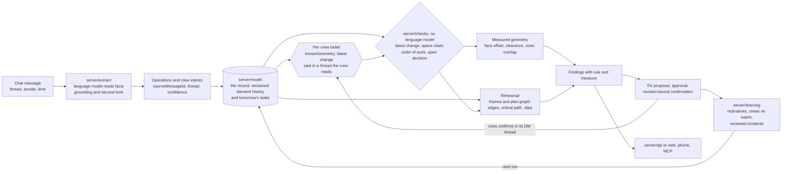

# Architecture

Owner: A. Read before adding a module or a dependency. All site data is simulated.

## One loop, one engine, two triggers

The language model turns messages into sourced facts. Everything after that is rules: the record, what each crew has heard, the four checks, the measured geometry and tomorrow's plan graph. The same checking engine runs at two moments: the instant a crew states a plan (live) and the evening before (rehearsal).

- Live trigger: a crew states an intent, `runChecks(scene, plan, intent)` runs at once.
- Evening trigger: a `rehearse` event in the replay steps tomorrow's plan, `rehearse(scene, plan)`, which also returns the plan graph.
- The pipeline runs in `server/model/replay.ts` (golden replay) and `server/api/session.ts` (live posts). Both pass the scene the message lands on to extraction.

## Rules that shape the code

- The language model extracts facts (`server/extract/`). Rules decide (`server/checks/`). No model call in checks, rehearsal or the plan graph.
- `npm run demo` plays `data/replay.golden.json` with `data/llm-cache/`. Live calls only with `LIVE_LLM=1`.
- Replay time only. Same input, same output. No randomness, no wall clock in logic.
- Every operation and finding carries `sourceMessageId` and is logged as one JSON line.
- Fail closed: an unsure fact is `unconfirmed` or a warning, a missing extraction is "not checked", never "clear". Nothing guesses a place, direction or distance.
- The flat SVG view and the 3D view render the same scene from `contracts/`.

## 1. Extraction: the language model reads (`server/extract/`)

- Demo mode reads `data/llm-cache/<messageId>.json` only. No entry: empty result, logged `extract.cache_miss`.
- `LIVE_LLM=1`: a cache entry still wins. Otherwise Groq extracts facts (`llm.ts`, plain `fetch`, JSON mode, temperature 0, waits and retries on 429). Its prompt lists the current scene's elements and crews and maps common trade words to task types (for example "boarding a wall" is close wall, "first-fix plumbing" is rough-in). Nicknames are resolved later by learning rules.
- `facts.ts` validates the raw reply; `result.ts` builds an `ExtractResult` checked by the zod schemas in `contracts/`. Ids, time, thread and `sourceMessageId` come from the message, and an intent takes the sender's crew. Live moves are measured from the current scene supplied by replay or the API.
- Rules guard what the model returns:
  - Unknown ids are dropped and an unknown intent place is left out. A move without direction or distance becomes `unconfirmed`.
  - Unit grounding: an element whose name carries a unit number counts only when the message says that number or one of the element's nicknames. A neighbouring unit's wall picked by the model is dropped, never remapped.
  - Cancelled plans: a crew dropping a stated plan becomes a cancelled task on a clear place, not an intent to work; `server/model/index.ts` then cancels the matching planned task.
- Second look (`missedCues`, `groqFacts` in `llm.ts`, live mode only): rules audit the reply. A message with a distance and a compass direction but no move, or with a decision word but no status change, is read again on its own with the cue named. Only changes the second reading actually returns are taken; nothing is ever filled in by rule. It is unit-tested (`second-look.test.ts`); its effect on the challenge set has not been scored in this branch. The demo never calls it, because cached readings win.
- Invalid JSON or schema: one retry with the error. Still invalid: empty result and `extract.error`, never a throw.
- A good live result is written to `data/llm-cache/`. `build-cache.ts` does this for every replay message in order (each on the scene the earlier ones built) and for scripted phone texts under their live id. `golden-rebuild.test.ts` proves rule changes do not alter any stored golden extraction.

## 2. The record and what each crew believes (`server/model/`)

- `applyOperations` adds each operation to the element's history (copy-on-write, deep copy only of changed elements). Every history row keeps its version, geometry or state, `sourceMessageId`, the thread it was said in and its confidence.
- Per-crew belief: a crew has heard a change when it was said in the drawing baseline, in a thread the crew reads, or in its own DM thread `dm:<crewId>`. `knownGeometry(element, crew)` is the geometry of the latest heard history row that has one. `server/checks/geometry.ts` keeps its own copy of this rule (`heardThread`, `knownGeometryEntry`, `unheardGeometryChanges`) so checks do not depend on the model; `web/src/derive.ts` mirrors it for the lens. Keep the three in step.
- Thread membership stands in for what a crew could have seen; it is not proof of what anyone read.
- `getPlan(scene, day)` gives one day's tasks in work order (slot, then order), cancelled tasks left out.

## 3. Checks: rules decide (`server/checks/`)

Four pure checks in `index.ts`: latest change, space clash, order of work, open decision. Each finding carries `sourceMessageId`, evidence messages, an optional `rule` (id and plain statement, for the trace) and, for geometric checks, an optional `measure`.

- Unsure means warn, not hold: a finding resting on a confidence below 0.7 (`UNSURE_BELOW` in `rules.ts`) or on an element in state `unconfirmed` is a `warn` with a note asking to confirm.
- A place id that is not an element on record gives no space clash or order-of-work finding.
- `fixes.ts` proposes one fix per finding with the crew message.

### Measured geometry (lane B)

- All numbers live in `server/checks/geometry-rules.ts`: per task type the clear depth the crew needs in front of a face (`clearanceM`, also the work-zone depth) and the face tolerance, each with a one-line reason; `HOLD_FROM_M` (0.05 m) and `MIN_OVERLAP_M2` (0.25 m²). Values were set from construction practice (a code reference where one exists, e.g. IPC 405.3.1 for fixtures; otherwise marked as assumptions), not tuned on the labelled cases.
- Plane geometry is pure and tested in `geometry.ts`: shoelace area, convex hull, half-plane clip, Sutherland-Hodgman intersection (the clip polygon must be convex; non-convex shapes are hulled first, which can only enlarge a zone), wall faces and strips.
- latest_change (`measure.ts` `measureClearance`): walls are thick segments. The work side is the side of the wall's centre line holding more of the task's place; with no place or an even split both faces are measured and the nearer is used (on a tie, the face where work would run into the wall). The offset is perpendicular to the believed wall, between the face the crew believes in and the recorded face. Moved into the work side beyond tolerance: `inside_new_wall`; away: `gap`; else `within_tolerance`. Hold at or above `HOLD_FROM_M` beyond tolerance, otherwise warn; the unsure rule still downgrades. Filled into `finding.measure.clearance` and the summary; `ghost` is unchanged. Non-wall elements keep the plain hold. On the simulated golden data the ghost wall (W-12) measures: west face, 0.40 m east, `gap`, rough-in needs 0.60 m clear, tolerance 13 mm, hold.
- space_clash (`workZone`, `measureOverlap`): each task's zone is the strip along each named element inside its place (in the crew's believed geometry), or the whole place when it names none; several strips join by convex hull. Two crews at overlapping times clash when the zones share at least `MIN_OVERLAP_M2`, whatever their place ids (rule `space_clash.overlapping_work_zones`). A zone that cannot be drawn falls back to the same-place-id rule, unmeasured (`space_clash.same_place_and_slot`). Filled into `finding.measure.overlap` and the summary.

### Order of work and open decision

- order_of_work uses `PREREQUISITE_RULES` in `rules.ts` with the same candidate and "finishes before" functions as the plan graph below, so a `prerequisite_later` finding sits exactly on a violated graph edge of a finding rule. Live intents use those functions without building the graph.
- open_decision: the work touches an element still `proposed`, or (for tile, paint and fixtures) a task-relevant proposed material or fixture inside its place. Tile, close wall and fixture installation are holds; other work is a warn.

## 4. Rehearsal and the plan graph (lane C)

`rehearse.ts` steps one day's plan in order for the slider. `server/checks/graph.ts`, pure, builds the plan graph; `rehearse()` returns it as `graph` (contracts `PlanGraph`) next to the frames whenever there is a frame, and `GET /api/rehearsal` passes it through.

- Nodes: the rehearsed day's planned tasks plus, transitively, the planned tasks on other days they wait on. Done and cancelled tasks are not nodes; a done prerequisite satisfies its rule, so nothing blocks.
- Edges come from `PREREQUISITE_RULES`, same place (same place id or a shared element), place on record. Per rule: if some candidate finishes before the task starts (done, earlier slot, or the same crew earlier in its own order) the task waits on those; otherwise every candidate is an edge with `violated: true`. full_day overlaps both halves.
- Rules: inspection before close wall (mandatory), close wall before finish drywall, finish drywall before paint, plumbing rough-in before tile; these also drive order_of_work. Graph only, no finding: an inspection needs the rough-in (plumbing or electrical) of the crew that booked it, because the task type does not say which trade is inspected.
- Critical path: the chain of at least one edge with the most half-day slots (morning or afternoon 1, full_day 2). Ties: the predecessor with the smallest id, then the end task with the smallest id.
- Slips: for every node, the tasks that can no longer start as planned if it finishes one slot late, pushed along the edges. Slots run morning, afternoon, next calendar day (no working calendar).
- On the simulated golden Saturday: three edges; the critical path is the 203 inspection then closing the 203 corridor wall, and that edge is violated (the existing order-of-work case). Slips: the 201 plumbing rough-in blocks tiling, the 203 inspection blocks drywall.

## 5. Send, confirm, recheck

- Listen step (`fixes.ts`): each silent crew gets a question instead of a HOLD; system DMs are not crew replies. If every crew is silent in the evening, the fix becomes `ask_crew`. Without chat history, low-confidence tasks retain the confirmation fallback. A warning never becomes a work instruction.
- Approval (`approveFix` in `server/api/session.ts`) sends the fix's messages into `dm:<crewId>`. For a latest-change HOLD it also stores a receipt with a revision snapshot of each element. Sending does not count as hearing: the finding stays open and the UI shows it amber. Approving a WARN only sends the confirmation request; it creates no geometry operation.
- `POST /api/fixes/:id/acknowledge {crewId}` is an explicitly simulated crew confirmation. It creates a sourced crew message in the crew's DM thread and a geometry-history acknowledgement of the dispatched position, so the crew's belief now matches the record and the checks stop flagging it. A newer revision supersedes the snapshot and the old confirmation is rejected with HTTP 409. Duplicate confirmation is idempotent. `GET /api/acknowledgements` lists receipts; receipt state is session-local.
- Live findings re-check themselves after every message (`server/model/resolve.ts`, replay and live posts): a finding the checks no longer reproduce, or whose crew tasks are all cancelled, leaves `findings` together with its pending fix and logs `finding.resolved`. Findings with an approved or rejected fix are left alone. Resolved items stay in server-only lists so the site agent can still send CLEAR.
- Evaluation measures active and resolved live alerts together with rehearsal alerts. A successful correction cannot erase a catch or an earlier false alarm from the measured history.

## 6. Learning and review memory (`server/learning/`, `server/api/`)

- `POST /api/corrections` stores a correction. It does not change the current run.
- `POST /api/reset` drops the session. With `keepLearning` (default `true`) the stored corrections stay; `false` starts clean and clears persisted learning.
- The next run starts from `learning.applyToScene(startScene)`: each stored nickname is added to its element's `aliases`. Extraction gets `learning.getContext()` (nicknames and crew notes).
- Right after extraction, `learning.resolvePlaces` fills the place of any intent that has none when the message names exactly one known nickname (element aliases plus stored nicknames, word-boundary match). No match or several: the intent keeps no place and the message is listed by `GET /api/unresolved` until a `location_alias` correction answers it. A rule, not the model, so the cached demo shows learning too.
- `GET/POST /api/dismissals` and `POST /api/dismissals/:id/undo` keep exact-incident review memory, scoped to sources, crews, element revisions and task context. Changed evidence brings the incident back. Checks, findings and evaluation are untouched.
- Persistence is opt-in via `LEARNING_FILE` (loaded once at start, rewritten after each correction); review preferences go to `<LEARNING_FILE>.dismissals.json`. No model is retrained.

## 7. Session, sheets and time travel (`server/api/`)

- `server/api/session.ts` holds one session. The server plays the golden replay right after listen (`server.warmup`); requests during it await the same session. Live messages are added on top.
- Live messages get a word-based id, `live-<10 hex of sha256(normalised text + crewId)>` (`server/api/live-id.ts`), and extraction reads `data/llm-cache/<that id>.json`. A repeat in one session is stored as `<id>-2` but reads the same cache entry.
- `GET /api/state?t=` replays from the start scene with stored corrections applied, like a new run; memoised in `state-at.ts`.
- `GET /api/sheets` derives a separate explicit-text ledger of sheet revisions from recorded messages. Authorized office roles issue revisions; crews state their revision. Unknown, conflicting or tentative text remains uncertain. No attachment is read and no fifth core check is added. A sheet mismatch is review evidence, not work clearance.
- Shared contracts for acknowledgements, sheets and dismissals live in separate files under `contracts/src/`, exported by the entry point. When a route or response shape changes, `API_VERSION` in `contracts/src/index.ts` is bumped so the web app can tell anyone on an older server to restart it.

## Other consumers of the same record

### Crew questions (`server/query/`)

- `POST /api/ask`, `GET /api/briefing`, `GET /api/digest`, mounted from `server/api/index.ts` via `handleQueryRoute`.
- Parse order: cache `server/query/cache/` -> live Groq if `LIVE_LLM=1` -> deterministic keyword parser -> not found (forwarded to the superintendent). Every parse goes through `guard`: unknown ids become not found.
- The model only turns the question into a structured query; `answer.ts` computes the answer by rules from scene, plan, findings and messages, with sources. "Can I start" runs the four checks on a synthetic intent and answers HOLD or CLEAR.
- Any question asking to change the design, choose a material or decide is escalated to the superintendent. `parse.ts` (`matchElements`) names walls by token overlap; a tie or no match is not found and says what was missing.

### Site agent (`server/agent/`)

- `policy.ts`: pure `decide(input) -> Action[]` on the replay clock (send_dm, escalate, follow_up, auto_resolve). No model. It never approves a HOLD.
- `runner.ts` steps it; the session runs it after the replay, after each live post and after each approval. Its DMs join the chat as `agent-<action id>` in `dm:<crewId>`. Timeline: `GET /api/agent/log`.
- Quiet hours 21:00-06:00: crew DMs wait until 06:00. A silent crew is asked, followed up at 07:00, then escalated 60 min later.
- `profiles.ts`: a crew that missed a change or left a question unanswered goes on watch; `POST /api/reset {keepLearning:true}` stores it as a `crew_misread` correction for run 2.

### MCP (`mcp/`)

- Own workspace, stdio transport, `@modelcontextprotocol/sdk`. Reads the site only over HTTP (`SITE_API`), never imports server code.
- Read-only tools (`tools.ts`): state, plans, findings, rehearsal, element history, `check_plan`, `is_place_clear`, `ask_site`. No tool approves or posts. A latest-change finding whose correction was sent but not confirmed is marked `awaitingConfirmation`. `demo-robot.ts` is a route planner that knows the site only through MCP. Details: `mcp/README.md`.

## Web (`web/`)

- Flat SVG plan is the default and the fallback. With the server down on first load it draws the contract fixtures with a banner.
- 3D view: `web/src/three/ModelView3D.tsx`, lazy-loaded behind a Flat | 3D toggle; a second renderer of the same scene.
- "See the floor as" lens, flat and 3D: elements are drawn from `beliefGeometry` / `beliefState` (`derive.ts`, the same heard rule as the checks). In 3D, walls glide in `useFrame` by mutating refs (no setState, demand frameloop); the record where the crew differs is a dashed outline mounted once and toggled visible. Ghosts are hidden (not unmounted) under a lens. "Who knows what" (`Knowledge.tsx`) shows every change against every crew: heard, not heard, or not heard where the checks find that crew's work meets it.
- "How it decided" (`web/src/Trace.tsx`, pure logic in `web/src/howDecided.ts`): one finding traced as message -> facts the language model read (plan tasks and element history rows in the scene that carry that `sourceMessageId`, with their confidence) -> `finding.rule`, labelled "Rules, no language model" -> the finding with `finding.measure` numbers -> its fixes. Fix status comes from `/api/fixes` plus `/api/acknowledgements`: sent is "waiting for reply" until a receipt says confirmed. A missing step says "not found" or "not recorded"; nothing is inferred. Opened from each incident card and from the inspector; store field `trace`.
- Measured drawings, only when the fields are present (`web/src/depth.ts`): the flat view draws `measure.clearance` (work-zone hatch, recorded face in ink, believed face in redline unless within tolerance, a note such as "0.40 m gap · needs 0.60 m clear") and `measure.overlap` (each crew's zone dashed in its hue, the shared area hatched in redline with its area). The timeline ("Show crew plan") draws `rehearsal.graph`: arrows between bars (critical path heavy ink, violated edges dashed redline), bars of one crew stacked when they share a slot, an "If this slips" readout for a selected bar, and the critical path in the rehearsal header. Absent fields draw nothing extra.
- Sample data for those fields lives in `web/src/fixtures/laneSamples.ts` (tests, and the dev-only `?sample=lanes` flag, which shows a banner). It is dynamically imported only in a dev build, never in the live data path.
- Crew phone: `/phone` route (`web/src/Phone.tsx`) and an inset on the main screen; posts to `POST /api/message`.
- Presenter mode: `?present=1` or key P, `web/src/present/`. Each beat calls the same store actions and the phone's own send path. Beats and phone texts are in `beats.ts`.

## Tests, e2e, video

- `npm test`: unit tests in `contracts`, `server`, `eval`, `mcp` and `web/src` (root `vitest.config.ts`).
- `e2e/`: `npm run e2e` spawns a real server (`node --import tsx server/index.ts`, port 8790, `LIVE_LLM=0`) and the MCP robot, and walks the demo beats in order over HTTP. Imports no server code.
- `video/record-present.mjs`: standalone (not a workspace), drives the presenter with playwright-core and Edge against a running demo; a take with any failed beat or page error is saved as `-FAILED`. `video/record.mjs` is the older button-driven recorder.

## Workspaces

| Workspace | Runs with | Notes |
|---|---|---|
| `contracts` | imported as `@site/contracts` | zod schemas + types, fixtures at `@site/contracts/fixtures` |
| `server` | `tsx` | plain `node:http`, port 8787 |
| `eval` | `tsx` | imports the replay from `@site/server/replay` |
| `web` | Vite | proxies `/api` to the server |
| `mcp` | `tsx` | MCP server over stdio, talks to the server over HTTP |

## Dependencies

| Package | Where | Licence |
|---|---|---|
| zod | contracts | MIT |
| @modelcontextprotocol/sdk | mcp | MIT |
| react, react-dom | web | MIT |
| three, @react-three/fiber, @react-three/drei | web | MIT |
| zustand | web | MIT |
| @fontsource-variable/archivo | web | OFL-1.1 (font) |
| vite, @vitejs/plugin-react, vitest, tsx, typescript, concurrently | dev | MIT / Apache-2.0 |
